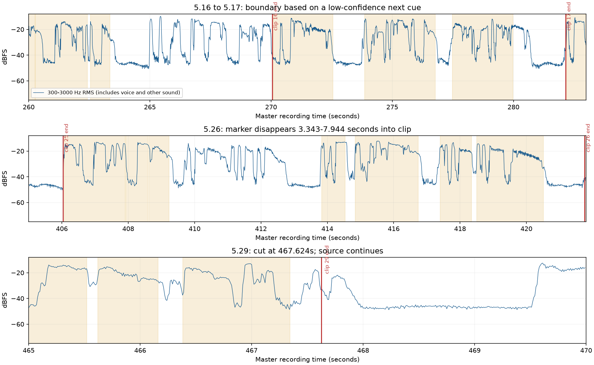

# Chapter 5 playback review — 1 October 2026

The two reported problems are supported by the local evidence. The review also found a misplaced verse boundary, unreliable word alignment, a fullscreen CSS collision, and several reading and playback-feedback problems. Repair the source boundaries and alignment before polishing the marker.

## Scope and evidence

Reviewed the current local Chapter 5 audio reader (`gita/5/`), all 29 MP3 clips, all 260 word/group cues, the 517.120-second master, cached alignment/transcription, and shared reader/build scripts. No rendered Chapter 5 video was present in this workspace; these findings concern the reader and the audio from its referenced Rajshri Soul recording.

This is a browser, timing, decoded-audio, waveform, and offline-ASR audit. It is **not a certified human listening review of every Sanskrit syllable**. ASR is approximate and sometimes produces mixed scripts or incorrect words. Its output was used as diagnostic evidence, never as replacement Sanskrit. Confirmed software/data defects and audio-boundary inferences are distinguished below. The manifest remains `machine-aligned`.

## Repair update

The shared fullscreen collision and playback feedback have been fixed in the reader. Clips and timings for 5.16, 5.17, 5.26, and 5.29 were rebuilt from explicit source windows. The revised 5.17 now includes its formerly missing opening, 5.26 has first-line cues through the former voiced marker gap, and 5.29 ends after the last recovered cue with a short tail before the colophon. The detailed findings below remain useful for the remaining listening review; they describe the pre-repair state where they refer to the old clip timings.

Evidence is preserved in [chapter-5-review/](chapter-5-review/): timing audit, browser results, audio measurements, fresh diagnostic transcription, screenshots, waveform plot, and the scripts used for this review. The playback code, timing manifests, Sanskrit, and audio clips were not changed.

## Findings and suggested corrections

| Priority | Finding | Evidence and consequence | Suggested correction |
|---|---|---|---|
| P1 | **5.16 contains the opening of 5.17; 5.17 starts partway through its first line.** | 5.16's last cue ends at master **263.348 s**, but its clip ends at **270.056 s**. 5.17 starts at **269.911 s**, and its long first-line cue covers only **270.091–272.549 s**, with score **0.281**. The source waveform contains a new recited phrase around 265 s; fresh slice transcription recognizes the first line of 5.17 across this earlier region. This is strong evidence of several seconds assigned to the wrong shloka. Exact syllable boundaries need listening. | Review master **262–274 s**; correct the complete first-line window for 5.17; re-align it; rebuild **both** clips and their cues. A marker-only change cannot recover the missing opening in 5.17. |
| P1 | **5.29 stops while the final voice sound is still present.** | The clip stops at master **467.624 s**, exactly 0.280 s after the aligned last cue. Voice-band energy continues after this cut and decays near 467.95 s; the final 100 ms of the clip measures **−18.80 dBFS**, well above the quiet background. Cached ASR puts the end near 467.84 s. These independently support the user's abrupt-ending observation; the precise consonant must be checked by ear. | Recover the complete final syllable and its natural decay, then retain a short quiet ending. Choose the cut before the closing colophon from the source audio. Apply any tiny fade only after speech completes. The final clip needs an explicit ending policy because it has no next-verse boundary. |
| P1 | **Fullscreen collapses the page to the button's width.** | The button and root `<html>` share class `gita-fullscreen`. The unscoped button rule assigns `display:grid`, `place-items:center`, and **width:2.5rem** to the root when fullscreen is enabled. Measured root width: **40 px** at a 1280 px viewport. Sanskrit and controls move offscreen. Reproduced in fresh Edge contexts; a temporary root-width/display override restored the composition. | Scope control styling to `button.gita-fullscreen`, or use a distinct root mode class. Regression-test actual fullscreen at portrait and landscape sizes. |
| P1 | **The marker disappears during spoken audio because cue endpoints are wrong.** | The reader highlights only when `start <= currentTime < end`, and clears the marker in every uncovered interval. In **5.26**, no cue exists from clip **3.343–7.944 s** (master **409.232–413.833 s**). The waveform and two transcript passes show recitation within that interval. The three first-line cues were compressed into the beginning of the line. Browser seeking to 4.7 s produces no active word, as the code dictates. | Re-align 5.26 with the complete first-line audio. Review other low/short cues, especially 5.5, 5.14, 5.15, 5.17, and 5.28. Retaining a marker may improve continuity but must not disguise incorrect acoustic timing. |
| P2 | **Very short cues flash too briefly to follow.** | **23 of 260** cues are shorter than **120 ms**, across 15 verses. Examples: 5.1 `च` **20 ms**; 5.5 `स` **20 ms**; 5.28 `एव` and `सः` **40 ms each**. Four cues have score 0. The CSS color/background transition is itself 120 ms, so these cues can end before the visual change completes. A high alignment score on a tiny cue does not establish readability or correct timing. | Audit suspicious durations against the audio. Use immediate active-state styling or a shorter transition. If a syllable is genuinely short, consider a readable phrase-level visual treatment without inventing a longer spoken interval. |
| P2 | **Pause extension trusts an unreliable next cue and duplicates source ranges.** | `extend-gita-clip-pauses.py` extends each nonfinal clip to 35 ms before the next aligned first word. It calls this silence without detecting silence. This amplifies the bad 5.17 cue into the 5.16 boundary defect. **26 neighboring pairs overlap by 144–145 ms**, one pair by 1 ms; 5.8→5.9 has a 7 ms gap. The overlap is definite; audible stutter at every pair is not certified. | Establish a shared, reviewed split point in a genuine quiet region. Ensure adjacent clips do not duplicate audible syllables. Flag long tails, uncertain next cues, and nonquiet cuts instead of extending blindly. |
| P2 | **5.8 and 5.9 have no trailing cue margin.** | Their last word/group cue reaches the clip's end. Their final 100 ms levels are **−18.02** and **−19.20 dBFS**. 5.9 has only **7 ms** before its first cue, and 5.10's first cue starts at 0. These are boundary-review flags; the connected 5.8–5.9 passage may intentionally have little pause. | Listen to each as a standalone selected clip as well as during auto-next. Preserve complete phonemes; do not force silence or a fade across continuous recitation. |
| P2 | **Large word groups make the marker too coarse.** | 5.8's whole second line is one cue lasting **7.165 s**; 5.9's opening group lasts **5.550 s**. Similar long groups occur in 5.17, 5.24, 5.27, and 5.28. A listener sees a large block remain highlighted while several words are recited. | Preserve the approved Sanskrit spelling and sandhi. As a separate design improvement, support timed subranges within a displayed group, or a clearly deliberate phrase marker. Do not insert arbitrary spaces and leave old cue indices in place. |
| P2 | **Small-screen wrapping harms readability despite passing overflow tests.** | At 390 px with English word meanings, 5.8 wraps its long final group so the ending `न्` sits on a separate row; punctuation may occupy another row. There is no horizontal overflow, so the current layout assertions accept it. | Add visual checks for orphaned syllables, punctuation, and stacked long glosses. Adjust the long-group layout and allow intentional linguistic wrap points. Keep captions optional. |
| P2 | **Overflowing fullscreen text is centered above its scroll origin.** | Fresh fullscreen tests show 5.8's first word above its scroll container while `scrollTop=0` (at 390×844: first word y≈41, container begins y≈122). The centered flex layout also shrinks line boxes. This needs retesting after the root-class collision is fixed. | After fixing the collision, use safe centering or top alignment when content overflows, and prevent line shrinkage. Ensure scrolling reaches the first and last word and that the active word remains visible. |
| P3 | **Loading and chapter completion lack clear feedback.** | With a 1.5 s delayed clip response, the player says “Pause shloka” and has `aria-busy=true`, but its visible status is empty and time remains 0. At the end of 5.29 with auto-next enabled, the reader correctly stops on the last verse, but again shows no completion message. | Show a compact loading state while awaiting audio and a localized “Chapter 5 complete” state at the end. Let the final verse remain visible. Preserve repeat precedence and lazy loading. |

The gold regions are current cues; white regions have no active marker. The blue curve is measured 300–3000 Hz audio energy, which includes voice and any other sound. Energy alone cannot identify a Sanskrit word. Red lines are clip cut points.

## Why the existing checks missed these defects

The Chapter 5 validator **passes**: count, file presence, source hash, token order, cue bounds, and matching JS/JSON are correct. Those properties do not establish that the cues describe the sounds at those times.

All **260 cue-midpoint browser probes** activate the expected displayed group. This proves the reader applies its manifest correctly; it does not prove the manifest is acoustically correct. All **232 normal-page layout cases** (29 verses × two languages × four widths: 320, 390, 768, 1280 px) pass overflow and gloss-count checks. They do not detect orphaned syllables or fullscreen failure.

The normal browser review recorded no page-script errors. No MP3 was fetched before Play, including after selecting every verse. Language and caption changes preserved playback; repeat took precedence over auto-next; auto-next moved to the following verse; a simulated 404 produced an error and navigation to a valid clip recovered. All 29 decoded MP3 durations match the manifest. These working behaviors should be preserved.

The alignment pipeline has no minimum anchor-coverage test before `np.interp`. The cached transcript includes Latin-only spans around **302–332 s** (5.19–5.21), which the Devanagari normalizer discards. Interpolated windows there need review, though this audit did not establish a specific audible defect in every one of those verses. Cached alignments are reused by filename without checking the audio hash, input text, window bounds, or model configuration.

## Correction order

1. Repair 5.16/5.17, 5.26, and the final 5.29 cut; review 5.8/5.9/5.10 seams and 5.28's final words.
2. Review every short/low-confidence cue and the 5.19–5.21 anchor-poor region. Rebuild only affected clips/cues and invalidate their caches explicitly.
3. Fix the fullscreen class collision; retest scroll reachability and short-height layouts.
4. Improve marker rendering, long-group readability, loading feedback, and chapter completion.
5. Run the structural/browser regressions, then listen through all 29 clips while watching the marker. Check each clip standalone, during repeat, and across auto-next transitions. Record exact reviewed ranges before upgrading the review status.

## Lessons for future chapters

- **Separate structural validity, acoustic timing, and reading quality.** Report each independently; passing one does not certify the others.
- **Validate boundaries before adding pauses.** A low-confidence next cue must never become the only authority for extending the preceding clip.
- **Use the audio as the timing authority.** Never repair errors by spreading cues evenly, clamping them until assertions pass, or keeping a marker continuously active over incorrect cues.
- **Create an automatic review queue.** Flag tiny cues (including high-confidence ones), zero/low scores, long uncovered regions containing sound, excessive tails, insufficient head/tail margins, nonquiet cut points, and overlapping source ranges. Thresholds initiate review; they are not universal rules for Sanskrit phonemes.
- **Fingerprint alignment inputs and clips.** Cache keys should include master hash, exact tokenization, windows, transcript, and model/settings. Record clip hashes and the actual build/extension recipe too. The old Chapter 5 record still describes a shorter first-verse duration than the current file.
- **Test representative failures, not just happy-path positions.** Include voiced gaps, the final phoneme, first/last words, long compounds, real fullscreen, short screens, slow network, repeat, and auto-next. A screenshot or midpoint test is not a listening audit.
- **Keep a specific ending requirement.** Include the complete final recitation, quiet decay, and a clear completion state, with closing colophon treatment recorded separately.

## Verse-by-verse numerical review queue

“Unmarked gap” is the largest interval between cues, not a claim that every such interval contains speech. Many are real pauses. “Tail” is the time between the last cue endpoint and clip end, not proof of silence. Short = <120 ms; low = score <0.5. A row without an additional outlier is not manually certified.

| Shloka | Clip s | Short cues | Low cues | Largest unmarked gap s | Tail s | Follow-up |
|---|---:|---:|---:|---:|---:|---|

| 5.1 | 18.040 | 1 | 2 | 1.786 | 1.278 | Review short/low cues |
| 5.2 | 18.008 | 0 | 0 | 1.567 | 1.374 | No additional numerical outlier; listening still needed |
| 5.3 | 15.423 | 3 | 1 | 1.667 | 1.198 | Review short/low cues |
| 5.4 | 15.023 | 0 | 0 | 1.712 | 1.253 | No additional numerical outlier; listening still needed |
| 5.5 | 14.345 | 1 | 5 | 1.899 | 0.869 | Review short/low cues |
| 5.6 | 16.686 | 0 | 0 | 1.532 | 1.531 | No additional numerical outlier; listening still needed |
| 5.7 | 15.487 | 1 | 0 | 1.646 | 1.370 | Review short/low cues |
| 5.8 | 15.043 | 0 | 0 | 1.145 | 0.000 | No cue tail; review standalone cut |
| 5.9 | 13.951 | 0 | 1 | 2.191 | 0.000 | No cue tail; review standalone cut |
| 5.10 | 16.166 | 2 | 2 | 1.923 | 1.531 | Review short/low cues |
| 5.11 | 14.742 | 0 | 0 | 2.004 | 1.740 | No additional numerical outlier; listening still needed |
| 5.12 | 15.566 | 0 | 1 | 1.712 | 2.091 | Review short/low cues |
| 5.13 | 15.023 | 0 | 1 | 1.577 | 1.403 | Review short/low cues |
| 5.14 | 14.609 | 2 | 3 | 2.412 | 1.513 | Review short/low cues |
| 5.15 | 15.538 | 2 | 3 | 2.830 | 1.822 | Review short/low cues |
| 5.16 | 20.869 | 1 | 0 | 2.011 | 6.708 | Opening of 5.17 falls in this clip; repair boundary |
| 5.17 | 12.246 | 0 | 1 | 1.305 | 2.174 | Opening line compressed/missing; score 0.281 |
| 5.18 | 13.869 | 0 | 0 | 1.595 | 1.367 | No additional numerical outlier; listening still needed |
| 5.19 | 15.909 | 1 | 1 | 1.931 | 1.754 | Latin ASR region; weak/missing anchors |
| 5.20 | 15.540 | 1 | 0 | 1.509 | 1.534 | Latin ASR region; weak/missing anchors |
| 5.21 | 15.379 | 1 | 0 | 1.349 | 1.492 | Latin ASR region; weak/missing anchors |
| 5.22 | 15.846 | 3 | 1 | 2.255 | 1.614 | Review short/low cues |
| 5.23 | 16.330 | 1 | 0 | 1.293 | 1.622 | Review short/low cues |
| 5.24 | 16.019 | 1 | 0 | 2.177 | 1.592 | Review short/low cues |
| 5.25 | 16.142 | 0 | 0 | 2.227 | 1.551 | No additional numerical outlier; listening still needed |
| 5.26 | 15.867 | 0 | 1 | 4.601 | 1.247 | Speech continues within 4.601 s blank-marker gap |
| 5.27 | 17.264 | 0 | 0 | 0.601 | 1.856 | No additional numerical outlier; listening still needed |
| 5.28 | 15.052 | 2 | 2 | 1.677 | 2.435 | Review short/low cues |
| 5.29 | 13.987 | 0 | 0 | 1.570 | 0.280 | Source voice energy continues after end cut |

## Reproduction and review identity

- Local URL: `http://127.0.0.1:43128/gita/5/`; browser: installed Microsoft Edge, headless Playwright. Physical phones, Safari, Firefox, and deployed/CDN behavior were not tested.
- Run `python authoring/scripts/preview-site.py --port 43128`, then `node authoring/docs/gita/chapter-5-review/review-browser.cjs` and `node authoring/docs/gita/chapter-5-review/review-extra.cjs`. These diagnostic scripts use the bundled Playwright package path from this workstation and write their evidence next to themselves; adapt that tooling path on another machine.
- `review-audio.py` uses the existing local NumPy/SciPy/Matplotlib/faster-whisper environment, cached Whisper small model, and FFmpeg. Its ASR output is deliberately uncorrected diagnostic data.
- Master SHA-256: `9d9b2c6ec17d66be86945142f179c88d287d203a95c556b2381236cf3b3a178a`.
- Timing manifest SHA-256: `7137d2b61ba04ce258a776609246c6d02376f4d858529fb65b37148ced2220f8`.
- Shared reader SHA-256: `f8a8555e43b398bb605f54a6889f3d7851344f104af06cde4ae7d5f3ce6b3c4f`.
- Shared CSS SHA-256: `e1d7fe34909823245572db14d7927155e63223cd314342d001c6d603c25885f6`.
